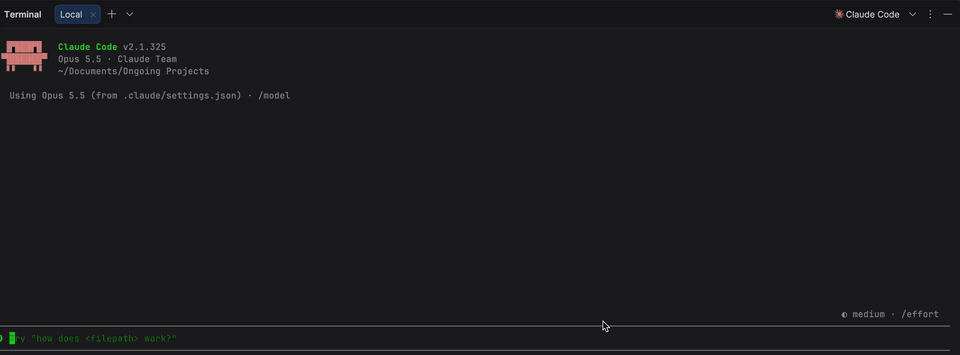

# Thirsty Claude

A Claude Code mod that shows, beside the chat, how much water your session has cost: a tap dripping into a one-litre bucket. The bucket fills as tokens are spent, the tap drips while a reply is running, and past one litre the water spills over the rim.



```
      THIRSTY CLAUDE
  what this chat costs in water

           (tap and bucket)

🪣  Session       ≈ 0.37 L
💬  This prompt   ≈ 25 mL

   accuracy: ±1 order of 2
   Need insight?
```

The desktop app draws an animated SVG. A terminal session gets a box-character bucket with a falling drop.

## Install

One install at the user scope covers every way you run Claude Code on that machine: the terminal, the desktop app and the IDE extensions all load the same plugins.

### Terminal

At the prompt of a Claude Code session:

```
/plugin install thirsty_claude --marketplace masudurHimel/thirsty-claude
```

Answer `y` to add the marketplace, then pick a scope; user is the usual one. The mod is active in that session at once.

### Shell

From any shell, without opening a session:

```bash
claude plugin install thirsty_claude --marketplace masudurHimel/thirsty-claude
```

This is the route to use in scripts and on machines you set up by hand. Sessions started afterwards load it; a running one needs `/reload-plugins`.

### Desktop app (macOS, Windows)

The `/plugin` command does not run in the desktop app's Code tab. Instead:

1. Click **+** next to the prompt box, then **Plugins**.
2. Choose **Add marketplace** and enter `masudurHimel/thirsty-claude`.
3. Choose **Add plugin** and pick `thirsty_claude`.

Or run the shell command above and then `/reload-plugins` in the open session.

### VS Code and JetBrains

The extensions run the same Claude Code engine and read the same user-scope plugins. Install with the shell command above, then start a new session in the IDE or run `/reload-plugins` in an open one.

### Verifying

```bash
claude plugin list
```

should show `thirsty_claude@thirsty-claude` with status enabled. In a session, `/thirsty_claude` opens the pane.

### Updating

```bash
claude plugin marketplace update thirsty-claude
```

```bash
claude plugin update thirsty_claude@thirsty-claude
```

Then `/reload-plugins` in any open session. To have Claude Code do this on its own at session start, add `"autoUpdate": true` to the marketplace's entry under `extraKnownMarketplaces` in `~/.claude/settings.json`.

## Using it

- The pane stays closed until you ask for it:

  ```
  /thirsty_claude
  ```

- Counting runs from the session's start regardless, so the bucket is right whenever you open it.
- Close the pane with its cross; `/thirsty_claude` brings it back at the same level.
- The count is per session and starts at zero with each new session.
- Three rows under the bucket: the session's all-in water, this prompt's, and the share of the session's used at the data centre itself ("On-site only"), which is the boundary Google reports against.

## How the water is estimated

**Short version:** nothing here is measured. Anthropic publishes no energy or water figures for Claude: its October 2026 S-1 filing and Public Benefit Report carry none [[6]](#sources), and independent trackers report the same gap [[5]](#sources). The mod takes the token counts the API reports for every response, weights them by how much work each kind of token causes, converts to energy with a per-model rate scaled by the model's price, and converts energy to water with the figures published for Anthropic's hosts. The method follows the best-sourced of the other meters, drip [[10]](#sources) and EcoLogits [[11]](#sources), and the level is checked against the one measured Claude Code workload [[8]](#sources). The result is an estimate: actual use may range from half to twice the figure shown, as explained below.

### Where water goes

AI uses water in two places:

1. **Cooling the data centre.** Many sites use evaporative cooling, which turns fresh water into vapour that is not recovered. Google reports a 2024 fleet-average water-use effectiveness of about 1.1 litres per kilowatt-hour, the figure behind its 0.26 mL per median Gemini prompt [[1]](#sources). EcoLogits collects the range for Anthropic's hosts, AWS and Google, at 0.13 to 0.99 L/kWh with a power overhead (PUE) of 1.09 to 1.14 [[11]](#sources).
2. **Generating the electricity.** Gas, coal and nuclear plants use water for cooling. Li, Yang, Islam and Ren put the US-average water consumption of electricity generation at about 3.1 litres per kilowatt-hour, usually larger than the on-site figure [[4]](#sources); EcoLogits uses 3.13 [[11]](#sources). Hydro and wind use almost none.

The water factor is the sum, in the form EcoLogits and drip use:

```
water per kWh = WUE + PUE × EWIF = 0.5 + 1.12 × 3.13 ≈ 4.0 L
```

The on-site part is an eighth of that. The pane's "On-site only" row shows this share, which is the boundary Google reports against [[1]](#sources), so the two can be compared like for like.

### What is counted

Every model response carries four token counts. Each is weighted relative to one fresh input token:

| Token kind | Weight | Why |
|---|---|---|
| Fresh input | 1 | Processed once, in one parallel batch |
| Cache write | 1.25 | A fresh input plus the cost of storing it; the 5-minute cache's price ratio [[12]](#sources) |
| Cache read | per model: 0.025 to 0.1 | Served from the prompt cache; the model's cache-read price as a fraction of its input price [[12]](#sources) |
| Output, thinking included | 5 | Each generated token runs the whole model once |

The weighted sum is converted to energy at 0.5 Wh per thousand weighted tokens for a reference model priced at $20 per million output tokens, scaled by each model's output price as a proxy for how much silicon a token moves [[10]](#sources) [[12]](#sources). With the water factor above, that is about 2 µL per weighted token for the reference model:

| Model | Output price, $ per million | Cache-read ratio | Microlitres per weighted token |
|---|---|---|---|
| Fable 5.2, Mythos 5.2 | 40 | 0.025 | 4.0 |
| Fable 5.1, Fable 5, Mythos | 50 | 0.025 | 5.0 |
| Opus 5.5 | 20 | 0.05 | 2.0 |
| Opus 5, 4.x | 25 | 0.1 | 2.5 |
| Sonnet 5.5 | 10 | 0.05 | 1.0 |
| Sonnet 5 | 10 | 0.1 | 1.0 |
| Sonnet 4.x | 15 | 0.1 | 1.5 |
| Haiku 5.5 | 0.5 | 0.1 | 0.05 |
| Haiku 4.5 | 5 | 0.1 | 0.5 |
| anything else | 20 | 0.1 | 2.0 |

Price is set by the provider, so the proxy is rough: it understates a model priced for volume, Haiku 5.5 most of all.

"This prompt" is every response of the current turn, tool calls and subagents included. "Session" is every response since the session started. "On-site only" is the session's cooling water alone.

### A worked example

One step of a long session on Sonnet 5.5: 1,000 fresh input tokens, 2,000 written to cache, 100,000 read from cache, 500 generated.

```
weighted = 1,000 × 1 + 2,000 × 1.25 + 100,000 × 0.05 + 500 × 5 = 11,000
energy   = 11,000 × 0.5 Wh / 1,000 × (10 / 20) = 2.75 Wh
water    = 2.75 Wh × 4.0 L/kWh ≈ 11 mL, of which about 1.4 mL on site
```

Without the weights, the same step would count 103,500 tokens at a flat rate and come out many times higher. That is why cache reads matter: in a long coding session they are about 96% of all tokens [[8]](#sources).

### Where the numbers come from

- **The energy rate.** Benchmarks of open models on H100-class hardware (ML.ENERGY [[7]](#sources)), Epoch AI's per-query analysis [[2]](#sources) and Google's 0.24 Wh per median prompt [[1]](#sources) put a frontier model's output token in the range of 0.3 to 3 Wh per thousand, with input tokens a few times cheaper; drip's mid band for a $20 model is 0.2 Wh per thousand input and 1.0 per thousand output [[10]](#sources). Hausfather measured an eight-week Claude Code log of 3.2 billion tokens at about 170 kWh, with a plausible range of 70 to 330 [[8]](#sources). This mod's 0.5 Wh per thousand weighted tokens puts that workload at about 320 kWh on Opus 4.x, or 180 on Opus 5.5 with its cheaper cache reads, inside his range either way, where drip's mid band gives about 130. The constant was chosen to land there rather than at drip's, since a measurement outranks another estimate.
- **The price scaling.** drip's method [[10]](#sources): a model's output price against a $20-per-million reference. Fable at $50 is rated 2.5 times Opus 5.5 at $20. A judgement from price, not a measurement.
- **The weights.** Prefill of input tokens runs in one parallel batch; each output token is a separate pass through the model; cache reads skip most of the compute. The output weight of 5 matches drip's mid-band ratio [[10]](#sources). The cache weights are Anthropic's price ratios [[12]](#sources), which are the best public signal of relative cost. Couch's per-token factors for Opus, deliberately pessimistic and derived at a 100k-token context, give input 390, output 1,950, cache read 39 and cache write 490 Wh per million [[9]](#sources): ratios of 1 : 5 : 0.1 : 1.25, the same shape.
- **The water factor.** The middle of the host range EcoLogits gives for Anthropic [[11]](#sources), with the US-average grid figure of Li et al. [[4]](#sources). The range of the factor is 3.5 to 4.6 L/kWh.

### How accurate it is

The pane's footer says `accuracy: ±1 order of 2`: actual use may range from half to twice the figure shown. That range comes from propagating the plausible range of each input (energy per token, cooling water per kWh, grid water per kWh, the token weights) through the formula above, and from the one calibration point: the measured workload of [[8]](#sources) sits within a factor of two of this mod's figure for it. It is a judgement about the spread, not a measured error, since Anthropic publishes no ground truth. The uncertainty splits into:

| Source of error | Rough weight | Who can close it |
|---|---|---|
| Energy per token for Claude specifically | largest | Only Anthropic, by publishing per-query figures |
| Water intensity at the actual data centre | large | Anthropic or the cloud host; known only if traffic runs through Bedrock or Vertex in a named region |
| The weights and the price proxy | smaller | Better measurements of inference; the constants are tunable |

The other meters land in the same band for the worked example above: drip 0.25 to 35 mL with a mid of 5.7 [[10]](#sources), EcoLogits 2.7 to 7.3 mL counting output tokens only [[11]](#sources), against this mod's 11. They are modelled, not measured, so agreement between them is reassuring but not proof.

The older figure that circulates online, about 500 mL per 10 to 50 responses, comes from the 2023 version of [[4]](#sources) for GPT-3 on 2023 hardware. It is roughly 50 to 100 times this mod's rates. The 2025 company disclosures [[1]](#sources) [[3]](#sources) are far lower, mainly because of newer chips and better measurement.

### What would make it better

- Anthropic publishing energy and water per query, as Google did.
- Knowing the region and cooling design of the data centre that answered.
- Measured weights for cache reads and output tokens rather than price ratios.
- An energy rate from measurement rather than from price.

All constants sit at the top of `hooks/register.tsx`: `WUE_L_PER_KWH`, `PUE`, `EWIF_L_PER_KWH`, `REF_WH_PER_K_WEIGHTED`, `REF_OUTPUT_USD`, `WEIGHTS`, `MODELS`, `DEFAULT_MODEL`, `BUCKET_ML` and `ACCURACY_NOTE`. Change them there.

### Sources

1. Google Cloud, "Measuring the environmental impact of delivering AI at Google scale", August 2025. Median Gemini Apps text prompt: 0.24 Wh, 0.03 gCO2e, 0.26 mL water; 2024 fleet-average water-use effectiveness. Blog: https://cloud.google.com/blog/products/infrastructure/measuring-the-environmental-impact-of-ai-inference and paper: https://arxiv.org/abs/2508.15734
2. Epoch AI, "How much energy does ChatGPT use?", February 2025. About 0.3 Wh per typical GPT-4o query; about 2.5 Wh with a 10,000-token input. https://epoch.ai/gradient-updates/how-much-energy-does-chatgpt-use
3. Sam Altman, "The Gentle Singularity", June 2025. Average ChatGPT query: 0.34 Wh and 0.000085 gallons (about 0.32 mL) of water; no methodology given. https://blog.samaltman.com/the-gentle-singularity
4. Pengfei Li, Jianyi Yang, Mohammad A. Islam, Shaolei Ren, "Making AI Less 'Thirsty': Uncovering and Addressing the Secret Water Footprint of AI Models", 2023, revised 2025. On-site plus off-site (power generation) water method; US-average electricity water intensity about 3.1 L/kWh; the GPT-3 "500 mL per 10 to 50 responses" figure. https://arxiv.org/abs/2304.03271
5. Projet Celsius, "How much energy and water do Claude Fable 5.2 and Opus 5.5 use?", November 2026. Modelled: 2.8 Wh per 1,000 written tokens, 0.9 Wh per 1,000 read tokens, hosts' water-use effectiveness (Google 1.15, Microsoft 0.30, AWS 0.12 L/kWh). Notes that Anthropic publishes no figures. https://projetcelsius.com/en/blog/fable-5-2-opus-5-5-energy-water/
6. azvai, "Is Claude sustainable? Anthropic's environmental impact, per its S-1", 2026. Reports that Anthropic's October 2026 S-1 and Public Benefit Report give no energy, water or emissions numbers; quotes the CLEER dataset (Sustainable AI Group, September 2026): about 1.6 Wh per typical Opus 5 chat, about 43 Wh per agentic session. https://azvai.com/en/is-claude-sustainable/
7. ML.ENERGY Leaderboard, University of Michigan. Measured energy per request and per token for open models on H100-class hardware; the benchmark behind EcoLogits' and drip's output-token figures. https://ml.energy/leaderboard
8. Zeke Hausfather, "The real energy use of agentic AI", The Climate Brink, 2026. Eight weeks of Claude Code logs: 3.2 billion tokens, 96% cache reads, 0.4% output, about 170 kWh (70 to 330); notes that summing transcript lines without deduplication overcounts by about 2.2x. https://www.theclimatebrink.com/p/the-real-energy-use-of-agentic-ai
9. Simon P. Couch, "What's the environmental impact of Claude Code?", January 2026. Deliberately pessimistic per-token energy factors for Opus at a 100k-token context: input 390, output 1,950, cache read 39, cache write 490 Wh per million tokens. https://www.simonpcouch.com/blog/2026-01-20-cc-impact/
10. Beau Sterling, drip. Water meter for Claude Code and Codex with low, mid and high coefficient bands, per-model price scaling, cache ratios from pricing, and a research note citing each figure. https://github.com/beausterling/drip-ai-water-usage
11. GenAI Impact, EcoLogits. Methodology for energy and water of LLM inference: GPU energy per output token from ML.ENERGY, server power over latency, and water as WUE + PUE × EWIF with per-provider data-centre figures (Anthropic: PUE 1.09 to 1.14, WUE 0.13 to 0.99 L/kWh; US EWIF 3.13). https://ecologits.ai and https://github.com/genai-impact/ecologits
12. Anthropic, model pricing. Output prices and cache-read and cache-write prices per model, the source of the ratios above. https://platform.claude.com/docs/en/about-claude/pricing

Sources 1 to 3 are company disclosures. Source 4 is peer-reviewed academic work. Sources 5, 6 and 8 to 11 are third-party measurement, modelling and reporting, not audited. Source 12 is a price list.

## FAQ

### Why is it showing so much water?

- **It counts everything the session does, not just your typed prompts.** Every model response is counted: each tool-call step, each file read, each subagent. One prompt in a coding session can be dozens of responses.
- **Every response re-reads the whole conversation.** A long session carries hundreds of thousands of tokens of context into every step. Cache reads are charged at a tenth of a fresh token, but there are so many that they still add up.
- **Output is charged five times a fresh input token**, and reasoning tokens count as output. A reply that thought for a few thousand hidden tokens costs more than the visible answer suggests.
- **The rate is all-in.** About seven eighths of each figure is water used to generate the electricity, not water at the data centre. The "On-site only" row shows the cooling water alone.
- **Scale check.** A full day of agentic work on an Opus-class model can reach a few litres. That is under a minute of a shower, and a small fraction of a percent of the water behind a single beef burger. It looks large only because it is honest about the total, where a "per prompt" figure is not.

### How do you know the real figure is within half to twice this?

- **It is a judgement, not a measurement.** Nobody outside Anthropic can measure Claude's water use, because Anthropic publishes no energy or water figures. The range says how far off the estimate is likely to be, not that it has been checked.
- **What it rests on.** Four inputs with published or reasoned ranges: energy per token from benchmarks and disclosures [[1]](#sources) [[2]](#sources) [[7]](#sources) [[10]](#sources), cooling water and overhead for Anthropic's hosts [[11]](#sources), grid water per kWh from peer-reviewed work [[4]](#sources), and token weights from Anthropic's own price ratios [[12]](#sources). Propagating those ranges through the formula gives a spread of roughly a factor of two either way.
- **One measurement.** Hausfather's eight-week Claude Code log [[8]](#sources) is the only measured figure for this kind of workload. The mod's estimate for it lands inside his range: about 1.9 times his central value on Opus 4.x, about 1.1 times on Opus 5.5.
- **Independent cross-checks.** Estimates that used different methods, drip [[10]](#sources), EcoLogits [[11]](#sources), Projet Celsius per token [[5]](#sources) and CLEER per chat [[6]](#sources), land within about 2x of this mod. That is consistency, not proof.
- **What would settle it.** A per-query figure from Anthropic, as Google published for Gemini. The mod's prediction for a median text prompt on Sonnet 5.5 is about 2 mL all-in and 0.2 mL on site; if Anthropic publishes a number, that is the line to check it against.

### Does the mod itself use tokens?

Almost none. The mod never calls the model, never changes the system prompt, and its hook on the model's stream only reads the chunks and passes them on unchanged. The pane, the drip timer and the stored totals live in the engine, which the model never sees.

The one exception is the reply to `/thirsty_claude`, "Thirsty Claude is open." Claude Code keeps a plugin command's output in the transcript, so each time you open the pane about 20 tokens join the context and are re-read as cache reads on later steps. Across a session that is a fraction of a drop.

### Why does the count start at zero in every session?

The mod stores its totals in the session's state, which Claude Code keeps per session. A new session starts fresh. Closing and reopening the pane within a session does not reset it.

### Can I change the rates?

Yes. The water factor (`WUE_L_PER_KWH`, `PUE`, `EWIF_L_PER_KWH`), the energy rate (`REF_WH_PER_K_WEIGHTED`, `REF_OUTPUT_USD`), the token weights (`WEIGHTS`), the per-model price table (`MODELS`, `DEFAULT_MODEL`), `BUCKET_ML` and `ACCURACY_NOTE` are constants at the top of `hooks/register.tsx`. Edit them, run `claude plugin test .`, and reload.

## Related tools

This is not the only water or energy meter for Claude Code, and it was not the first. Others worth knowing, with what their methods do for the worked example above:

- **drip** reads local session logs, deduplicated by message id, and shows a live meter, a browser breakdown and a 30-day history; it also covers Codex CLI. Four token kinds, per-model price scaling, cache ratios from pricing, and sourced low, mid and high bands: 0.25, 5.7 and 35 mL for the example. The best-sourced of the set; this mod's 0.7.0 method follows it. https://github.com/beausterling/drip-ai-water-usage
- **water-footprint** by nlok5923 is a Stop hook that prints water per prompt: 11.7 mL for the example, with tiered per-model rates that are not cited, no range, and probably no subagent transcripts. https://github.com/nlok5923/water-script
- **thirsty-tokens** reads every transcript and offers a CLI, a desktop widget, an MCP server and a browser calculator. One rate for all models, derived from hardware, and a water factor of e L/kWh that its own notes call a joke: 3.4 mL. https://github.com/evanwang810/thirsty-tokens
- **EcoLogits** is a library that estimates energy and water for API-hosted models from model size and output tokens only, with the most careful data-centre factors: 2.7 to 7.3 mL. It ignores input and cache tokens, which are about 96% of a coding session. https://ecologits.ai
- **bytethirst** counts cache reads as full input and drops cache writes, with a near on-site-only water factor: 1.3 to 14 mL, plausible only because the errors offset.
- **aqua-wasted**, **claude-eco**, **claudewatts** and **ecologits-statusline** put water, energy or CO2 in the status line. aqua-wasted sums transcript lines without deduplication and prices cache reads as fresh input, from 2023 GPT-3 figures: 788 mL for the example, about 25 times the others. https://www.pkgstats.com/pkg:aqua-wasted and https://www.pkgstats.com/pkg:claude-eco and https://jonnonz1.github.io/claudewatts/
- **claude-carbon** tracks CO2 only, in the status line. https://sharedcontext.ai/plugins/external/gwittebolle/claude-carbon

What this mod does differently: it reads usage from each response as it streams, so the figure is live, per model, covers subagents and never double-counts; a drawn bucket in a pane rather than a line of text; drips tied to activity; and an on-site row beside the all-in total.

There is also an open request for a built-in water tracker in Claude Code: https://github.com/anthropics/claude-code/issues/24833

## Development

Run from a checkout without installing:

```bash
claude --plugin-dir /path/to/thirsty-claude
```

Check it:

```bash
claude plugin validate .
```

```bash
claude plugin test .
```

Type-check it once the engine has laid `.claude-plugin/types/` (it does so on first load):

```bash
npx -y -p typescript@5.6.3 tsc -p .
```

Layout:

- `.claude-plugin/plugin.json`: the manifest.
- `.claude-plugin/marketplace.json`: makes this repository installable as a marketplace.
- `hooks/hooks.json`: names the hooks module the engine loads.
- `hooks/register.tsx`: the hooks module. Counting on `turn.step`, the pane on `ui.render`, the command on `command.run`.
- `hooks/pane.test.tsx`: tests, run by `claude plugin test`.
- `types/index.d.ts`: the shape of the value the mod stores in session state.
- `tsconfig.json`: extends the engine-laid config so `tsc -p .` type-checks the mod.
- `CHANGELOG.md`: what changed in each version.

## License

MIT. See `LICENSE`.
